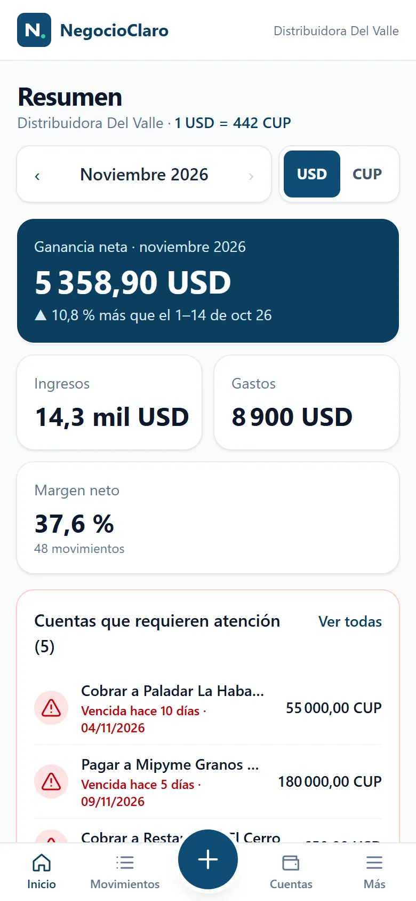
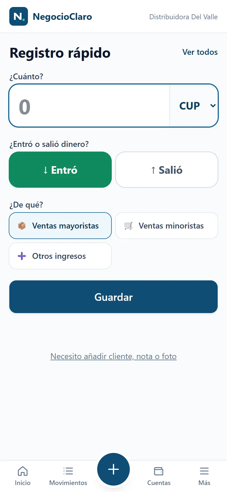
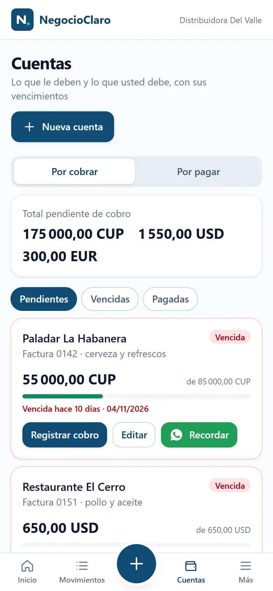
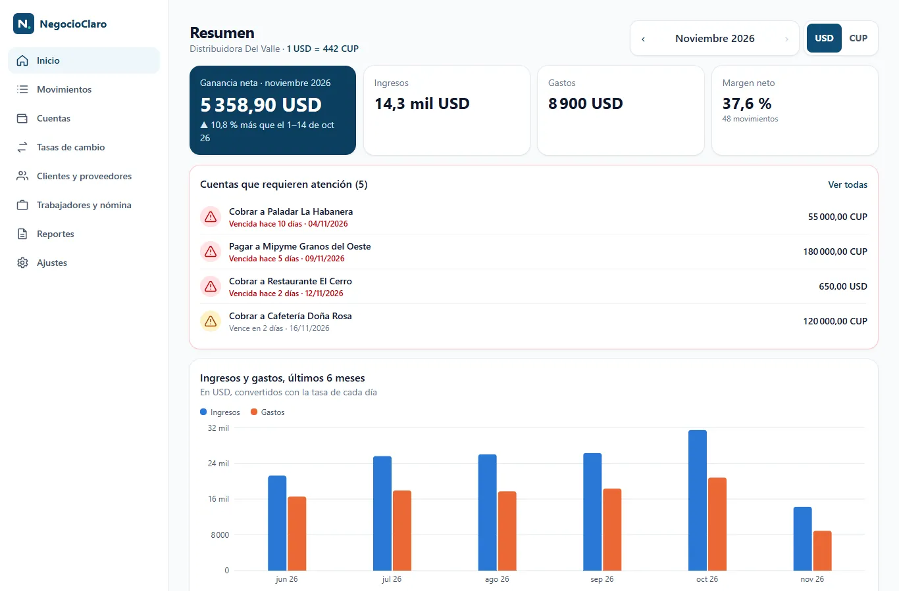
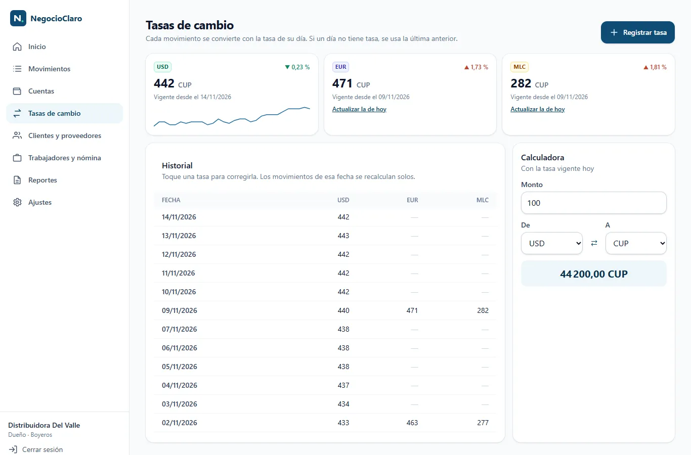
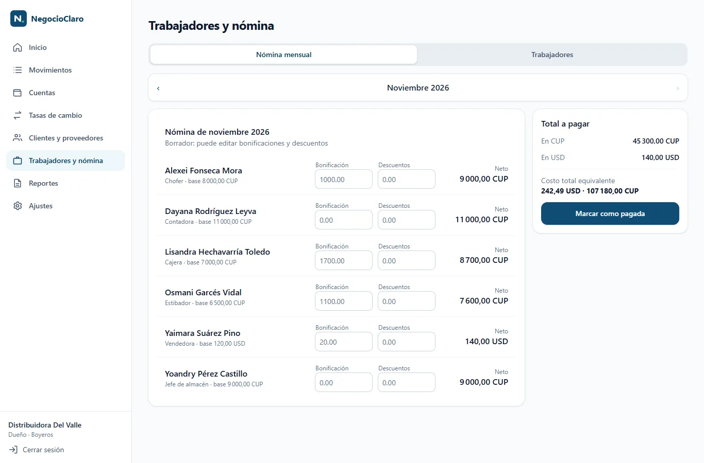

# NegocioClaro

**Sepa cuánto gana su negocio, en USD y en CUP.**
Dashboard financiero multi-moneda para mipymes cubanas: ingresos y gastos en USD, CUP, EUR y MLC consolidados con la tasa del día, nómina, cuentas por cobrar y pagar, e informe mensual para el contador. Funciona como app en el móvil (PWA) y está pensado para conexiones lentas.

[](https://github.com/Tiza-Coderz/negocioclaro/actions/workflows/ci.yml)

🔗 **Demo en vivo:** _pendiente de despliegue_ · 👤 **Usuario:** `admin@demo.cu` · 🔑 **Clave:** `demo1234`

> Negocio de ejemplo: **Distribuidora Del Valle** (Boyeros, La Habana), distribuidora mayorista de alimentos y bebidas con 6 meses de movimientos realistas.

---

## El problema

El dueño de una mipyme cubana cobra y paga en **cuatro monedas** (CUP en efectivo, USD por Zelle, EUR por TropiPay, MLC por transferencia), con una **tasa de cambio que cambia cada día**. Con libretas o Excel es casi imposible responder lo básico:

- ¿Cuánto **gané de verdad** este mes, en USD y en CUP?
- ¿Gané más o menos que el mes pasado?
- ¿En qué se me va el dinero?
- ¿Quién me debe y qué facturas ya vencieron?
- ¿Cuánto me cuesta la nómina?
- ¿Qué le doy al contador a fin de mes?

NegocioClaro responde esas preguntas en una pantalla, desde el móvil y aunque la conexión sea mala.

## Funcionalidades

|                                   |                                                                                                                                                                                                                                                            |
| --------------------------------- | ---------------------------------------------------------------------------------------------------------------------------------------------------------------------------------------------------------------------------------------------------------- |
| 📊 **Dashboard**                  | Ganancia neta del mes comparada con los mismos días del mes anterior, ingresos, gastos y margen. Barras de 6 meses, dona de gastos por categoría, flujo de caja acumulado, mejores clientes y alertas de cuentas. Totales en **USD o CUP** con un toque.   |
| 💱 **Tasas por fecha**            | El administrador registra o corrige la tasa de cada día (USD, EUR, MLC). Cada movimiento se consolida con **la tasa de su día** (o la última anterior). Corregir una tasa recalcula los movimientos afectados. Incluye historial, tendencia y calculadora. |
| 🧾 **Movimientos**                | Ingreso o gasto con fecha, monto, moneda, método (efectivo, transferencia, Zelle, TropiPay, Transfermóvil), categoría, cliente o proveedor, nota y **foto del vale** (comprimida a WebP en el móvil). Filtros, búsqueda y conversión en vivo.              |
| ⚡ **Registro rápido**            | Formulario de **3 campos** (¿cuánto?, ¿entró o salió?, ¿de qué?) para anotar una venta en 5 segundos. Recuerda la última moneda y categoría. Sin señal, se guarda al volver la conexión.                                                                   |
| 📅 **Cuentas por cobrar y pagar** | Vencimientos con estados (vencida, vence hoy, por vencer, al día, pagada), cobros y pagos parciales, pendiente por moneda y botón **Recordar por WhatsApp** con el mensaje ya redactado.                                                                   |
| 👷 **Trabajadores y nómina**      | Salarios en CUP o USD, nómina mensual con bonificaciones y descuentos, costo total equivalente; al pagarla se crean los gastos por moneda.                                                                                                                 |
| 👥 **Clientes y proveedores**     | Municipios de La Habana, llamada y WhatsApp con un toque.                                                                                                                                                                                                  |
| 📄 **Informe mensual en PDF**     | KPI, desglose por categoría, método de pago y moneda original, mejores clientes y cuentas vencidas. Resumen para enviar por WhatsApp.                                                                                                                      |
| 📤 **CSV para el contador**       | Un movimiento por fila con tasa aplicada y equivalentes USD/CUP. Abre bien en Excel en español (`;`, coma decimal, tildes).                                                                                                                                |
| 📱 **PWA instalable**             | Se instala en la pantalla de inicio, con atajos a Registro rápido y Cuentas y lecturas disponibles sin conexión.                                                                                                                                           |
| 🎭 **Modo demo**                  | Credenciales visibles en el login y botón **Restablecer demo**; se restablece sola cada madrugada.                                                                                                                                                         |

## Capturas

| Dashboard                                                    | Registro rápido                                                 | Cuentas                                                    |
| ------------------------------------------------------------ | --------------------------------------------------------------- | ---------------------------------------------------------- |
|  |  |  |

| Escritorio                                                             |
| ---------------------------------------------------------------------- |
|  |
|              |
|                      |

Más capturas en [`docs/screenshots`](docs/screenshots). Se regeneran con `npm run screenshots`.

## Stack

| Capa           | Tecnología                                                                                |
| -------------- | ----------------------------------------------------------------------------------------- |
| Frontend       | React 19, Vite 8, TypeScript 6 (estricto), Tailwind CSS 4                                 |
| Datos          | TanStack Query 5, Supabase JS                                                             |
| Gráficos y PDF | Recharts 3, jsPDF + autotable (ambos con carga diferida)                                  |
| Backend        | Supabase: Postgres, Auth, Storage, RLS, triggers y RPC                                    |
| PWA            | vite-plugin-pwa (Workbox)                                                                 |
| Calidad        | ESLint (typescript-eslint, jsx-a11y), Prettier, Vitest + Testing Library, pgTAP           |
| CI             | GitHub Actions: formato, lint, tipos, tests con cobertura, build, migraciones y tests SQL |

## Arquitectura

```
src/
├─ domain/       Reglas de negocio puras y testeadas (dinero, tasas, consolidación, cuentas, nómina, dashboard, informe)
├─ data/         Cliente Supabase tipado, repositorios y hooks de TanStack Query
├─ features/     Una carpeta por pantalla (dashboard, movements, quick-entry, rates, debts, contacts, payroll, reports, settings, auth)
├─ components/ui Componentes reutilizables y accesibles
└─ app/          Router, layout y proveedores
supabase/
├─ migrations/   Esquema, RLS, triggers de consolidación, storage, nómina y datos demo
└─ tests/        Tests pgTAP (consolidación, pagos de cuentas, nómina)
```

Puntos destacados (detalle en [`docs/arquitectura.md`](docs/arquitectura.md)):

- **Dinero sin coma flotante**: centavos enteros y `BigInt`, con un único redondeo igual al de Postgres.
- **La misma regla de conversión en la BD y en el cliente**, probada con **el mismo fixture** en Vitest y en pgTAP.
- **Multi-negocio con RLS**: el mismo despliegue puede servir a varios clientes.
- **Ligera**: carga inicial de ~175 KB gzip; gráficos y PDF solo cuando se usan.

**Tests:** 143 en Vitest (dominio, validaciones, CSV, PDF, componentes) y 28 aserciones pgTAP.

## Cómo correrlo en local

Requisitos: **Node 22+** y **Docker** (para Supabase local).

```bash
git clone https://github.com/Tiza-Coderz/negocioclaro.git
cd negocioclaro
npm ci

# 1. Base de datos local (Postgres + Auth + Storage en Docker)
npm run db:start            # imprime API URL, anon key y service_role key

# 2. Variables de entorno
cp .env.example .env.local  # pegue ANON_KEY y SERVICE_ROLE_KEY del paso anterior

# 3. Datos demo (6 meses) y usuario admin@demo.cu / demo1234
npm run seed

# 4. App
npm run dev                 # http://localhost:5173
```

Otros comandos:

| Comando                              | Qué hace                                                         |
| ------------------------------------ | ---------------------------------------------------------------- |
| `npm test`                           | Tests de Vitest                                                  |
| `npm run db:test`                    | Tests SQL (pgTAP)                                                |
| `npm run lint` / `npm run typecheck` | Calidad                                                          |
| `npm run db:reset && npm run seed`   | Base de datos desde cero                                         |
| `npm run db:types`                   | Regenera `src/data/database.types.ts`                            |
| `npm run screenshots`                | Capturas en `docs/screenshots` (con `npm run preview` corriendo) |

> El proyecto usa los puertos **553xx** para Supabase local (API en `http://127.0.0.1:55321`), para no chocar con otros proyectos.

## Despliegue gratis

Todo cabe en planes gratuitos: **Supabase Free** (BD, Auth, Storage) + **Vercel Hobby**, **Cloudflare Pages** o **Netlify** (frontend estático).

### 1. Supabase

1. Cree un proyecto en [supabase.com](https://supabase.com) (región cercana: `us-east-1`).
2. Aplique las migraciones:
   ```bash
   npx supabase login
   npx supabase link --project-ref <ref-del-proyecto>
   npx supabase db push
   ```
3. En **Authentication → Providers → Email**, desactive _"Allow new users to sign up"_: la demo solo usa el usuario sembrado.
4. Siembre la demo **desde su máquina** (la service role key nunca va al frontend ni al repo):
   ```bash
   VITE_SUPABASE_URL=https://<ref>.supabase.co \
   SUPABASE_SERVICE_ROLE_KEY=<service_role_key> \
   node scripts/seed.ts
   ```

### 2. Frontend (Vercel, Cloudflare Pages o Netlify)

- Importe el repo. Comando de build: `npm run build`. Carpeta: `dist`.
- Variables de entorno:
  `VITE_SUPABASE_URL`, `VITE_SUPABASE_ANON_KEY`, `VITE_DEMO_MODE=true`, `VITE_DEMO_EMAIL=admin@demo.cu`, `VITE_DEMO_PASSWORD=demo1234`, `VITE_CONTACT_WHATSAPP=53XXXXXXXX`.
- Las rutas de la SPA ya están resueltas: `vercel.json` (Vercel) y `public/_redirects` (Netlify y Cloudflare Pages).
- En Supabase, **Authentication → URL Configuration**: añada la URL del despliegue a _Site URL_ y _Redirect URLs_.

### 3. Mantener la demo viva

El plan gratuito de Supabase **pausa el proyecto tras 7 días sin actividad**. El workflow [`demo-diaria.yml`](.github/workflows/demo-diaria.yml) restablece la demo cada madrugada (los datos siempre terminan "hoy") y de paso la mantiene activa. Para activarlo, añada en GitHub los secrets `SUPABASE_URL` y `SUPABASE_ANON_KEY`.

## Licencia

MIT

---

## English summary

**NegocioClaro** is a multi-currency financial dashboard for small Cuban businesses (_mipymes_). Owners record income and expenses in **USD, CUP, EUR and MLC** paid by cash, bank transfer, Zelle, TropiPay or Transfermóvil. Each transaction is consolidated into USD and CUP using **that day's exchange rate**, which the admin can edit (falling back to the latest previous rate). The app covers payroll, accounts receivable and payable with due-date alerts and WhatsApp reminders, a 3-field quick-entry form for mobile, a monthly PDF report, and a CSV export for the accountant.

Built with **React 19 + Vite + TypeScript (strict) + Tailwind + TanStack Query + Recharts + Supabase** (Postgres with RLS, triggers and RPC), and installable as a **PWA** designed for slow connections. Money is handled as integer cents. The same conversion rule runs in the database and in the client, and both are tested against **one shared fixture** (Vitest + pgTAP). CI runs lint, type checks, tests, the build, migrations and the SQL tests. Demo login: `admin@demo.cu` / `demo1234`.
