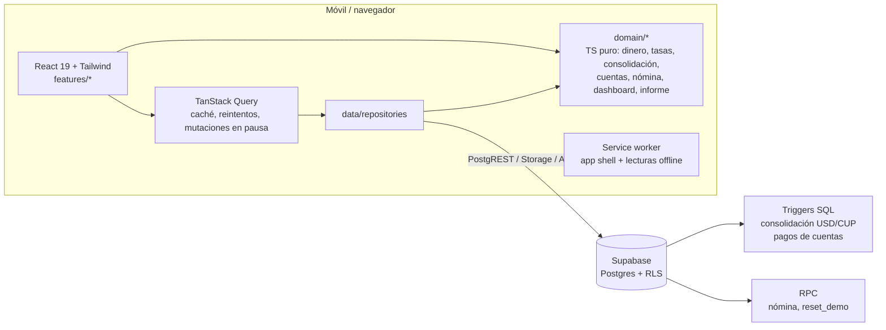
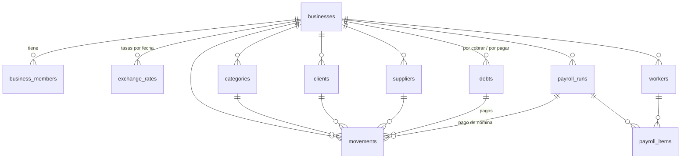

# Arquitectura de NegocioClaro

## Vista general

## Capas

| Capa            | Carpeta               | Responsabilidad                                                                                                                                    | Depende de             |
| --------------- | --------------------- | -------------------------------------------------------------------------------------------------------------------------------------------------- | ---------------------- |
| Dominio         | `src/domain`          | Reglas de negocio puras y testeadas: centavos enteros, tasa del día, consolidación, estados de cuentas, nómina, agregados del dashboard e informe. | nada                   |
| Datos           | `src/data`            | Cliente Supabase tipado (`database.types.ts` generado), repositorios que mapean filas ↔ dominio, hooks de TanStack Query y claves de caché.        | dominio                |
| Funcionalidades | `src/features/*`      | Pantallas por caso de uso (dashboard, movimientos, registro rápido, tasas, cuentas, contactos, nómina, reportes, ajustes, auth).                   | datos, dominio, UI     |
| UI              | `src/components/ui`   | Componentes reutilizables y accesibles (Button, Field, Dialog, Card, estados de carga/vacío/error, MoneyText, WhatsAppButton…).                    | dominio (solo formato) |
| App             | `src/app`             | Router con rutas protegidas y carga diferida, layout, proveedores de sesión y negocio.                                                             | todo lo anterior       |
| BD              | `supabase/migrations` | Esquema, RLS, triggers, RPC y datos demo. Tests pgTAP en `supabase/tests`.                                                                         | —                      |

## Decisiones clave

### Dinero sin coma flotante

Todos los montos se manejan como **centavos enteros**; las conversiones usan `BigInt` y un único redondeo (mitad hacia afuera del cero), idéntico a `round()` de Postgres sobre `numeric`. Hacia la API los montos viajan como **string decimal** (`"1234.56"`).

### Tasa del día con pivote en CUP

`exchange_rates` guarda cuántos CUP vale 1 USD/EUR/MLC cada día. Cualquier conversión A→B es `monto · tasa(A) / tasa(B)`. Si un día no tiene tasa se usa **la última anterior**; nunca una futura. Sin tasa previa, el movimiento queda marcado `missing_rate` y no cuenta en totales (se avisa en pantalla).

### Consolidación en la BD _y_ en el cliente

- La BD guarda una **foto consolidada** (`amount_usd`, `amount_cup`, `rate_date`) calculada por trigger: el dashboard no necesita joins y queda auditado con qué tasa se convirtió cada movimiento. Corregir una tasa **reconsolida** los movimientos afectados.
- El cliente tiene la **misma lógica** para la vista previa en vivo y la calculadora.
- Ambas implementaciones se prueban con **el mismo fixture** (`src/domain/__fixtures__/consolidation-cases.json` → Vitest y pgTAP generado).

### Multi-negocio y seguridad

Todas las tablas llevan `business_id`; RLS permite ver solo los negocios de los que el usuario es miembro. El rol _contador_ lee todo y solo escribe movimientos y tasas. `reset_demo()` es pública pero solo actúa sobre el negocio `is_demo` y con límite de 1 vez por minuto.

### Pensado para conexiones lentas

- Rutas con `lazy()`; Recharts y jsPDF en chunks que solo se descargan al usarse.
- Fotos de vales comprimidas a **WebP** en el móvil antes de subir (4 MB → ~150 KB).
- TanStack Query: 2 reintentos con espera creciente, sin recarga al volver a la pestaña, mutaciones en pausa sin señal.
- PWA: app shell precargado y lecturas de la API _NetworkFirst_ con caché.

### Visualización

Paleta categórica validada para daltonismo (orden fijo), un solo eje Y, tooltips, leyenda y vista de tabla: ningún dato depende solo del color.

## Modelo de datos (resumen)

